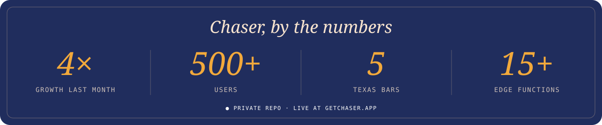

  

  
  
  
  
  

---

### 🍸 Now checked in at **[Chaser](https://www.getchaser.app/)**

Howdy, I'm Cayden. I'm co-founder and engineer at **Chaser by WNDR**, a rewards platform for bars, and I study CS (minor in Statistics) at **Texas A&M**.

- 🥃 **Built and shipped Chaser** in TypeScript / React Native (Expo). It **grew 4× last month** to **500+ users** across **5 Texas bars**
- 🗺️ Shipped **product redemption, bar onboarding, a friends network and check-in geofencing**
- 🧱 Built the backend on **Supabase (PostgreSQL)**: schema design, RLS policies, triggers, and **15+ Deno Edge Functions** with cron jobs
- 🧑‍🏫 Led **6 developers** through the Aggie Coding Club to build Chaser's **bottle-service queue**
- 🔬 ML research at TAMU on **Gaussian-process methods for alloy discovery**. Lead author of
  [*Good Enough is Better: Feasibility vs. Pareto-Optimality in Alloy Design*](https://pubs.rsc.org/dd/article/5/7/3010/1263213/Good-enough-is-better-feasibility-vs-Pareto) (Digital Discovery, 2026)
  and [*Residual Driving Force Minimization…*](https://papers.ssrn.com/sol3/papers.cfm?abstract_id=6865302) (presented at CALPHAD 2026)
- ☕ Side project: **[Caffeine Critique](https://caffeine-critique-1.onrender.com)**, a Flask app that predicts my coffee ratings with a mixed Gaussian process

### 🍺 On Tap

**App & backend**

**ML & data**

**Also pouring**

### 🧾 Your Tab

  

  

  

  

  

  

